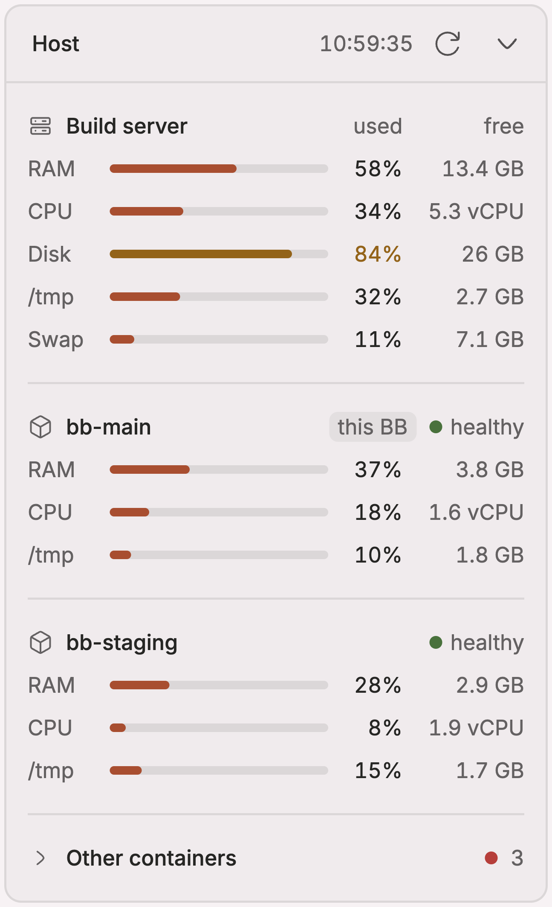
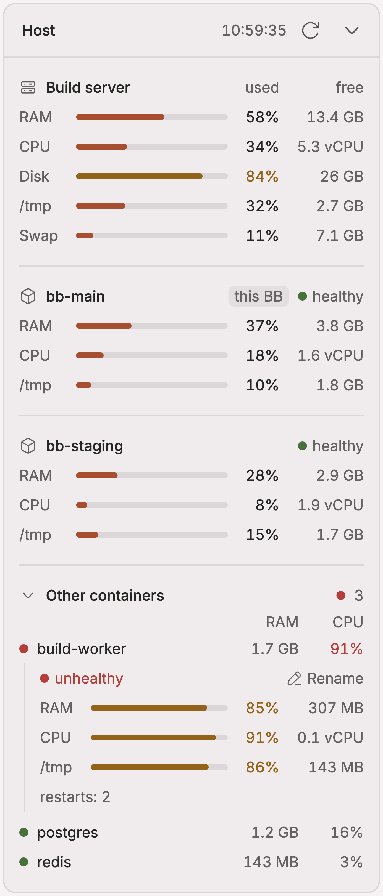

# Host Usage

Open the server icon in the BB sidebar footer for available RAM, CPU load, disk space, and temporary storage. The optional Linux collector adds BB instances and all containers visible to its local Docker or Podman engine, including stopped containers.

Every row reads the same way: name, a bar with the share in use, the percentage, and what is still free. Click a row for exact figures. The BB that serves the panel is marked **this BB** and listed first.

 

The screenshots show demonstration data.

## Rename the host and containers

Names come from the machine: the host name and the container or user name. Hover over a name and click the pencil to rename it. Leave the field empty to restore the original. For a container in **Other containers**, expand its row and click **Rename**.

Names are stored per BB installation in the plugin's storage, keyed by the container name. They survive container re-creation and collector updates. Nothing has to be configured on the host.

## Install in BB

Requires BB 0.50.1 or later and Plugin SDK 0.6.157 or later. Install directly from GitHub on the BB server.

```sh
bb plugin install 'git:https://github.com/docomoz/bb-plugin-host-usage.git@^0.1.0'
```

For a local source checkout, run the following from the directory that contains `package.json`.

```sh
npm ci
bb plugin install .
```

The panel can show the local machine and the current BB server process without additional setup. If BB itself is isolated in a container, connect the Linux collector for host-wide figures.

## Connect the Linux collector

Run `collector/collect.py` **on the host** with Python 3.9 or later. For native BB, run it as the BB account or arrange read access to the snapshot directory. For container metrics, the collector needs access to the local runtime and the relevant host cgroups and process mount information. Check its output before scheduling it.

```sh
python3 collector/collect.py --period 30 \
  --output "$HOME/.local/share/bb-host-usage/latest.json"
```

Schedule the same command every 30 seconds using your service manager. Set `--period` to match your schedule. BB looks for that file in the server user's home directory by default. Set **Collector snapshot path** in BB to use a different absolute path. With an explicit path, the panel reports an absent, unreadable, or stale snapshot.

If BB runs in Docker or Podman, let the collector deliver the snapshot to every BB container it finds. With `--publish-bb` it writes the file as the user that runs each BB server, under that user's `HOME`, at the path the plugin reads by default. New BB containers on the host are picked up without changes to the schedule.

```sh
python3 collector/collect.py --period 30 --publish-bb
```

A systemd service and timer for that command:

```ini
# /etc/systemd/system/bb-host-usage.service
[Unit]
Description=Collect host and BB resource metrics
After=docker.service

[Service]
Type=oneshot
ExecStart=/usr/bin/python3 -B /opt/bb-host-usage/collect.py --period 30 --publish-bb
UMask=0077
Nice=10
NoNewPrivileges=true
ProtectSystem=strict
TimeoutStartSec=30

# /etc/systemd/system/bb-host-usage.timer
[Timer]
OnBootSec=20s
OnUnitActiveSec=30s
AccuracySec=2s

[Install]
WantedBy=timers.target
```

To deliver to a single container, `--publish-docker my-bb --publish-user node --output /home/node/.local/share/bb-host-usage/latest.json` is still supported. A persistent mount with **Collector snapshot path** works too.

The plugin reads only a bounded JSON file. Docker sockets, process inspection, and any elevated privileges stay with the separately scheduled collector on the host. Keep the destination in a private directory. If the collector runs as root and writes a host file, use a directory controlled by its service account.

## Discover and name workloads

- Linux discovery recognizes standard BB server processes and maps them to local containers. Native entries show CPU and RSS for the BB server process.
- For custom images, or to keep a stopped BB container in the BB section, add the container label `host-usage.bb=true`. The label `host-usage.name` and the flag `--bb my-bb="My BB"` set a default name for every installation. Usually renaming in the panel is enough.
- The host name defaults to the machine's host name. `--name` sets a default for every installation.
- The default `--runtime auto` checks the local Docker socket and the local Podman inventory. Use `--runtime docker`, `podman`, or `none` to choose explicitly. Use `--docker-socket /absolute/path/docker.sock` for a different local daemon. Run the collector under the corresponding account to see that account's rootless Podman inventory.
- Detailed container RAM and CPU use cgroup v2 when accessible. Container `/tmp` shows the capacity and available space in its filesystem. The panel labels a shared filesystem when `/tmp` and the root filesystem are the same. Container RAM includes file cache and tmpfs. OOM counts come from the current cgroup. The host's CPU and container CPU are sampled over the same short interval.
- Container health comes from the engine's configured health check when present. A native or container process marked **Running** has been observed running.

## Develop and package

```sh
npm ci
npm run check
npm test
python3 -B -m unittest discover -s collector
bb plugin build
npm pack --dry-run
```

The versioned JSON contract is defined in `snapshot.ts`. A different host exporter can supply the same contract. `PLUGIN_OVERVIEW.md` is the description used in the BB Community marketplace.
